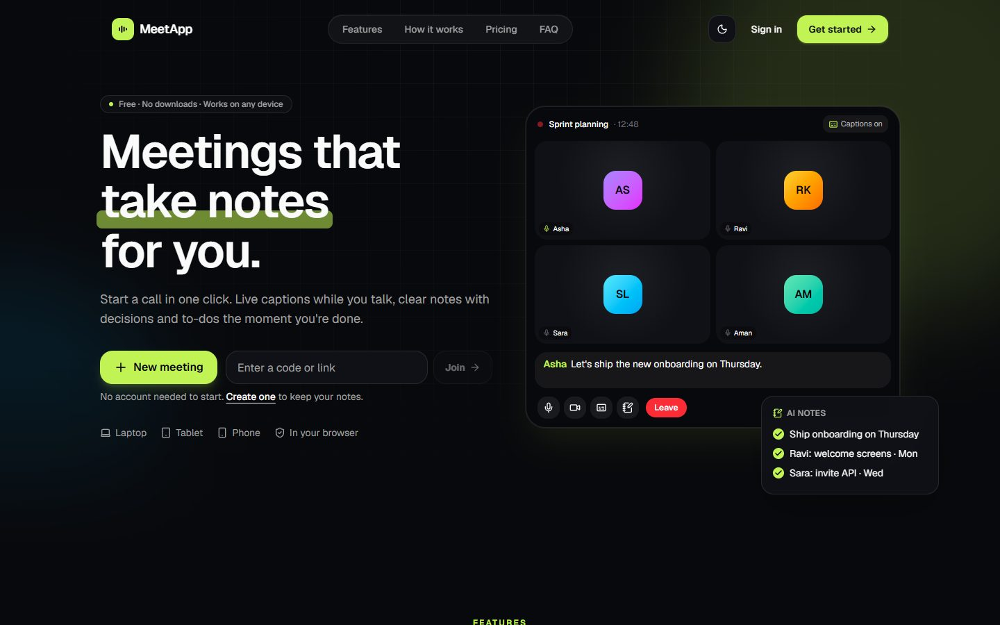
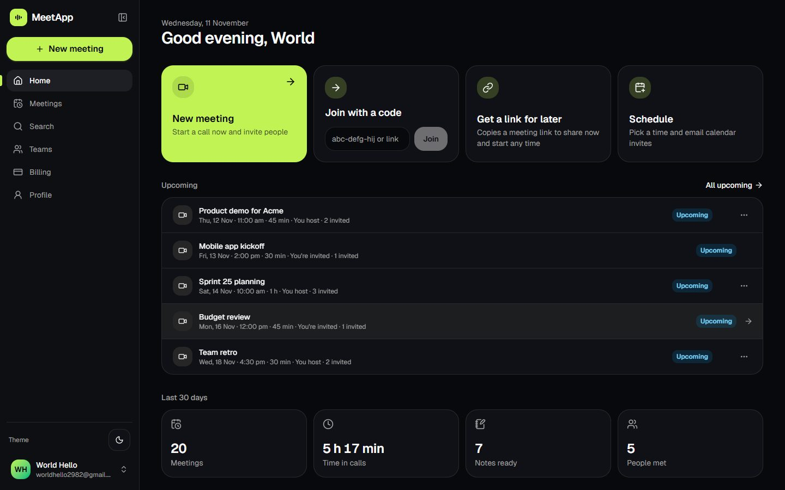
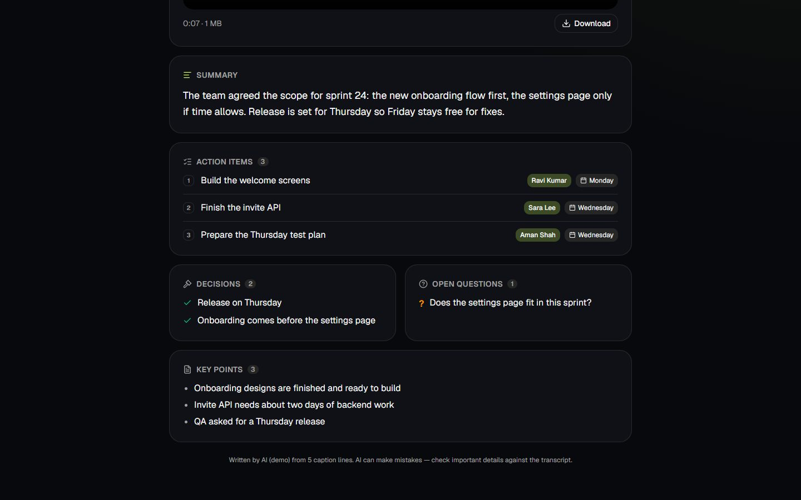
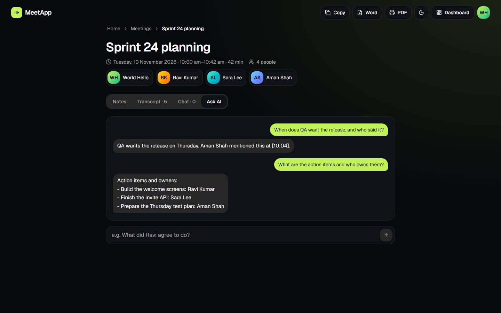
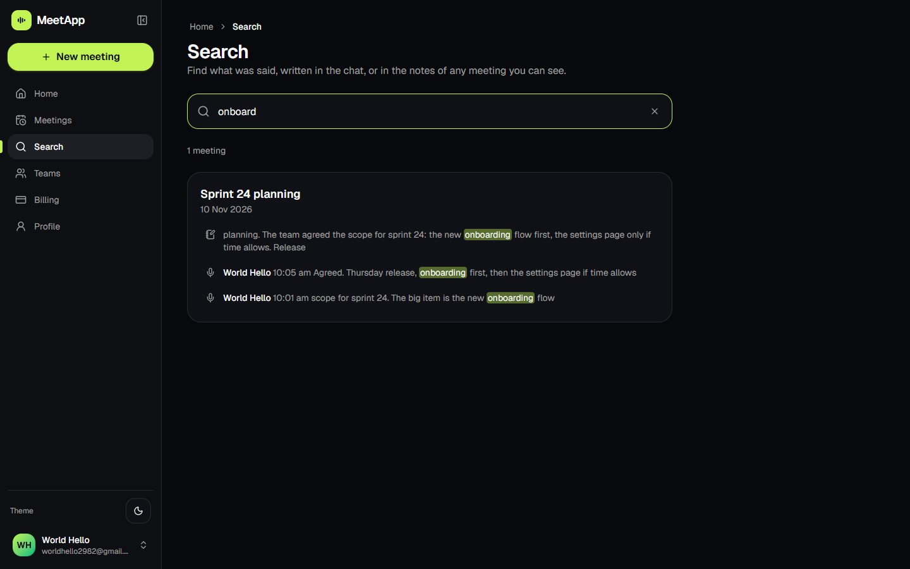
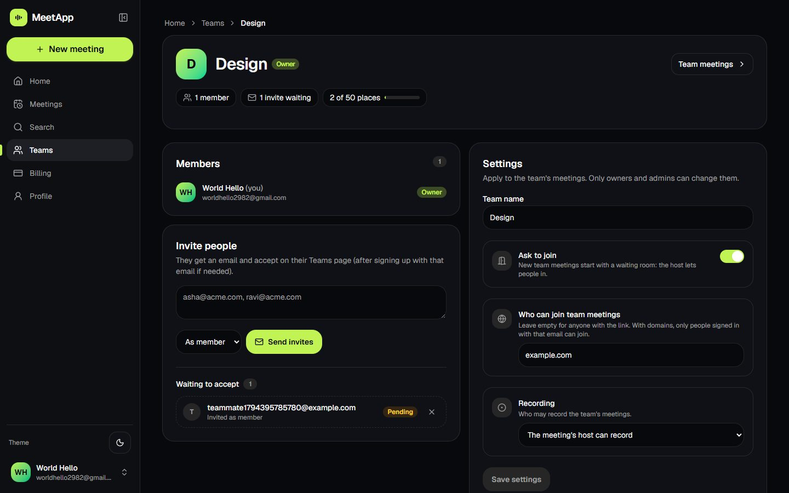
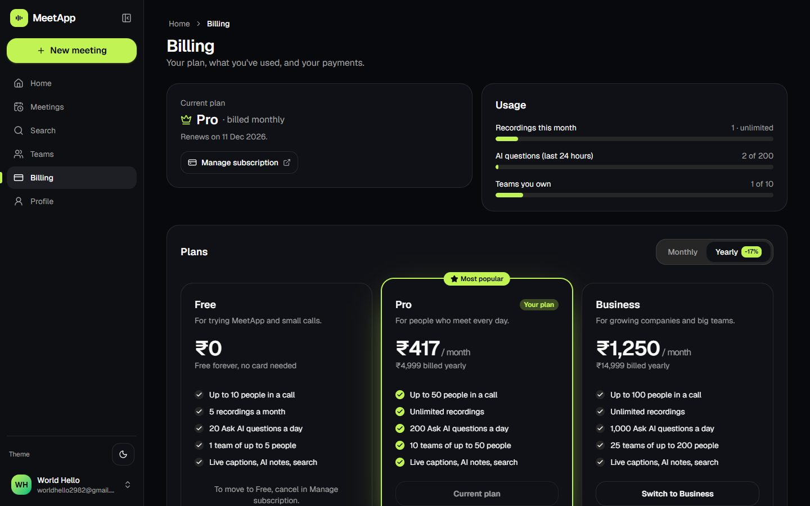
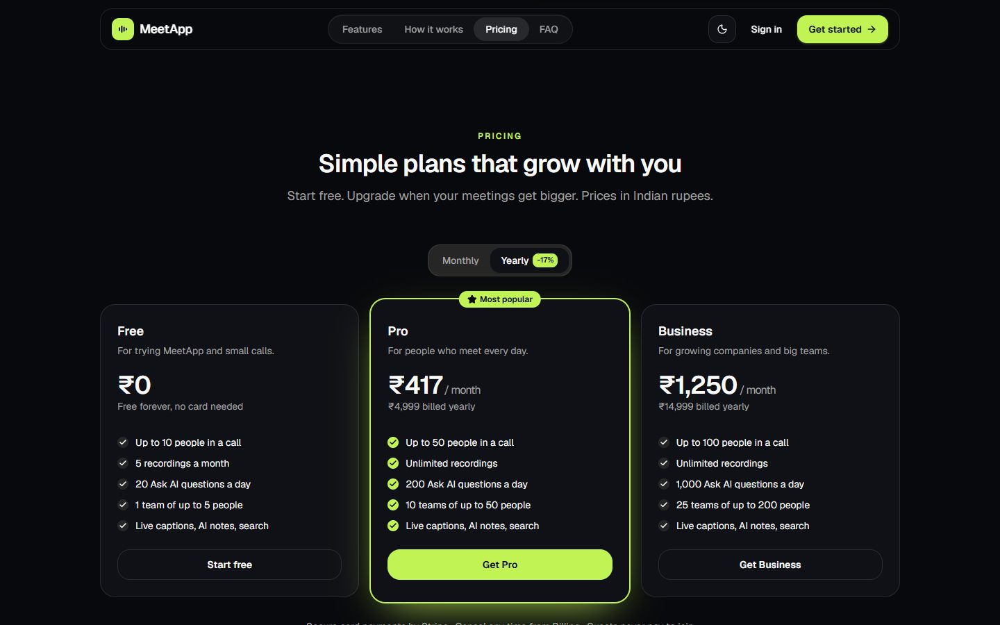
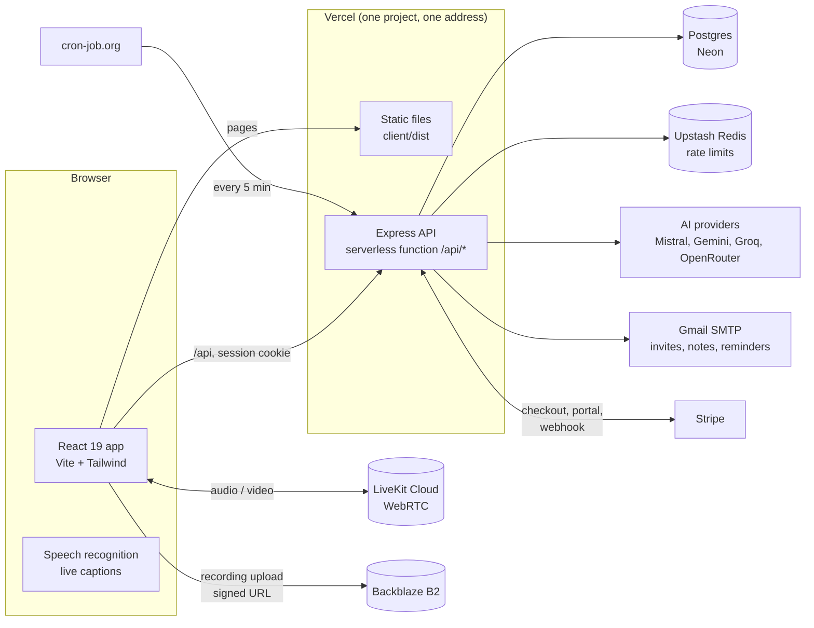

# MeetApp

**Video meetings that take notes for you.** Start a call in one click, get live captions while people talk,
and receive AI meeting notes (summary, decisions, action items) the moment the call ends. Then search
everything that was said, ask AI questions about any meeting, and share it all with your team.

**Live demo:** https://meet-app-xi.vercel.app (sign up free with email or Google; payments run in Stripe test mode)



---

## Screenshots

| Dashboard | AI meeting notes |
|---|---|
|  |  |
| **Ask AI about a meeting** | **Search across every meeting** |
|  |  |
| **Teams with admin settings** | **Plans and billing (Stripe)** |
|  |  |



---

## Features

**Meetings**
- One-click video calls in the browser, no app or account needed for guests (LiveKit WebRTC)
- Live captions in 10+ languages (English, Hindi, Gujarati, Marathi, Tamil, Telugu, …), each person picks their own
- Chat, reactions, raise hand, screen share, background blur (runs on the device)
- Host controls: "Ask to join" waiting room, lock, mute, remove
- Recording to cloud storage (Backblaze B2, uploaded straight from the browser), playback and download

**After the meeting**
- AI notes: title, summary, key points, decisions, action items with owners and due dates, open questions
- Notes emailed to everyone who joined; export as Markdown, Word or PDF; host can edit and regenerate
- Full transcript and chat kept with the meeting (downloadable)
- **Ask AI**: "What did we decide about the release?" answered only from that meeting, with who said it and when
- **Search** across titles, notes, transcripts and chat of every meeting you can see, with highlighted matches that jump to the exact line

**Scheduling**
- Schedule with calendar invites (.ics) that land in Google Calendar, Outlook and Apple Calendar
- Edit or cancel like Teams: guests get updated invites or cancellations on the same calendar event
- Recurring meetings (daily / weekly) as one calendar series with a link that always opens the current meeting
- Guests reply Yes / Maybe / No from the email; the host sees the counts
- Reminder emails 10 minutes before the start
- Personal calendar feed: subscribe once and every meeting stays in sync in your calendar

**Teams and plans**
- Teams with owner / admin / member roles, email invites, shared meetings and notes
- Team admin settings: "Ask to join" by default, only allow certain email domains, who can record
- Free, Pro and Business plans with limits enforced by the server
- Stripe Checkout (INR, monthly or yearly), customer portal to switch or cancel, payment history with invoices

**Accounts and security**
- Email + password (scrypt) or Google sign-in; email confirmation before using the app
- httpOnly session cookie that expires after 24 h of inactivity (never longer than 30 days); password changes sign out other devices
- Idle sign-out in the browser after 10 minutes (never during a call)
- Zod validation on both client and server, rate limits on every endpoint (shared through Upstash Redis)
- Installable as an app (PWA) with an offline page

---

## Architecture



- **One Vercel project:** the React app is served as static files; the Express app runs as a single serverless function for every `/api/*` request. Same address means simple, safe cookies (SameSite=Lax) and no CORS in production.
- **Video never touches the API:** browsers talk to LiveKit directly with a short-lived token the API signs.
- **Recordings never touch the API either:** the browser uploads to B2 with a pre-signed URL, then the API checks the file exists.
- **AI with fallbacks:** notes and answers try Mistral, then Gemini, Groq and OpenRouter, with retries for rate limits.
- **Background work without a server:** emails go out after the response (`waitUntil`); reminders run when an external scheduler calls a protected endpoint.
- **Billing source of truth is Stripe:** the plan is kept in sync by the webhook and by checking Stripe when the Billing page opens.

## Tech stack

| Area | Tools |
|---|---|
| Frontend | React 19, React Router, TypeScript, Vite, Tailwind CSS 4, Radix UI / shadcn, Zod, Sonner |
| Video | LiveKit (client SDK, server SDK, track processors for blur) |
| Backend | Node.js 22, Express 5 (MVC: routes, controllers, services, validators), Zod, Pino |
| Database | PostgreSQL (Neon in production), Prisma 7, full-text search with GIN indexes |
| Services | Stripe, Backblaze B2 (S3 API), Nodemailer (Gmail SMTP), Upstash Redis, Google Identity |
| AI | Mistral, Gemini, Groq, OpenRouter (OpenAI-compatible chat API) |
| Testing | Node test runner: 52 API tests on a separate test database, client validation tests, Playwright for browser checks |
| Hosting | Vercel (static + serverless), Neon, LiveKit Cloud |

---

## Run it locally

You need **Node.js 22+** and **PostgreSQL** installed on your computer.

1. In `server/.env` (copy `server/.env.example`), set at least:
   - `DATABASE_URL` → database `meetapp` (development) and `TEST_DATABASE_URL` → database `meetapp_test` (tests only)
   - `JWT_SECRET` (32+ characters), `CLIENT_URL=http://localhost:5173`
   - `LIVEKIT_URL`, `LIVEKIT_API_KEY`, `LIVEKIT_API_SECRET` (free LiveKit Cloud project)
   - optional: an AI key (`MISTRAL_API_KEY` / `GEMINI_API_KEY` / …), SMTP for real emails (without it emails are printed in the server log), B2 for recordings, Stripe for payments
2. Create the tables and start the backend:
   ```bash
   cd server
   npm install
   npx prisma migrate deploy
   npm run seed:demo   # optional: a demo account with meetings, notes and a recording
   npm run dev
   ```
3. In a second terminal, start the frontend:
   ```bash
   cd client
   npm install
   npm run dev
   ```
4. Open http://localhost:5173 → **New meeting** → copy the link → open it in a second browser window to join as another person.

**Payments locally (Stripe test mode):** put your `sk_test_…` key in `STRIPE_SECRET_KEY`, run `npm run stripe:setup` in `server`
(it creates the Pro and Business products with INR prices and prints the four `STRIPE_PRICE_…` values to add). Pay with the test card
`4242 4242 4242 4242`, any future date, any CVC. No Stripe CLI needed: the app checks Stripe when you return to the Billing page.

## Useful commands

| Where | Command | What it does |
|---|---|---|
| server | `npm test` | API tests (uses `TEST_DATABASE_URL`, never the live database, never sends email) |
| server | `npm run typecheck` | TypeScript check |
| server | `npm run db:migrate` | Create a migration after editing `prisma/schema.prisma` |
| server | `npm run seed:demo` | Demo account + sample data (local database only) |
| server | `npm run stripe:setup` | Create Stripe products, prices and portal settings (test mode only) |
| server | `npm run db:deploy:prod` | Apply migrations to the live database (`PROD_DIRECT_DATABASE_URL`) |
| client | `npm run build` | Production build (also type-checks) |
| client | `npm test` | Client validation tests |
| client | `npm run lint` | Lint (oxlint) |

## Deploy to Vercel (app + API on one address)

`vercel.json` builds both parts: the React app is served as static files and the Express API runs as one
serverless function (`api/index.js` → `server/dist/app.js`) for every `/api/*` request.

1. **Neon** (database): create a project, copy the **pooled** and **direct** connection strings, then create the tables:
   ```bash
   cd server
   npm run db:deploy:prod   # with PROD_DIRECT_DATABASE_URL in server/.env
   ```
2. **Upstash** (shared rate limits): create a free Redis database, copy the REST URL and token.
3. **Vercel**: Add New → Project → import this GitHub repo (framework: Other; settings come from `vercel.json`).
   Environment variables (Production): everything from `server/.env.example` with real values (no quotes), plus:
   - `NODE_ENV=production`, `CLIENT_URL=https://<your-app>.vercel.app`
   - `DATABASE_URL` = Neon **pooled** string, `DIRECT_DATABASE_URL` = Neon **direct** string
   - `VITE_GOOGLE_CLIENT_ID` = same as `GOOGLE_CLIENT_ID`
   - do **not** set `VITE_API_URL` (the app then calls `/api` on its own address)
4. After the first deploy, allow the live address:
   - Google Cloud → OAuth client → Authorized JavaScript origins → add `https://<your-app>.vercel.app`
   - Backblaze bucket browser rule (CORS) → add `https://<your-app>.vercel.app`
5. **Stripe** (test mode): Developers → Webhooks → add `https://<your-app>.vercel.app/api/billing/webhook` with the events
   `checkout.session.completed`, `customer.subscription.created`, `customer.subscription.updated`, `customer.subscription.deleted`;
   put its signing secret in `STRIPE_WEBHOOK_SECRET`.
6. **Reminders**: set `CRON_SECRET`, then on cron-job.org (free) call `GET https://<your-app>.vercel.app/api/cron/reminders`
   every 5 minutes with the header `Authorization: Bearer <CRON_SECRET>` (Vercel's free cron runs only once a day).

Every push to `main` deploys automatically. Run `npm run db:deploy:prod` **before** pushing a new migration.
